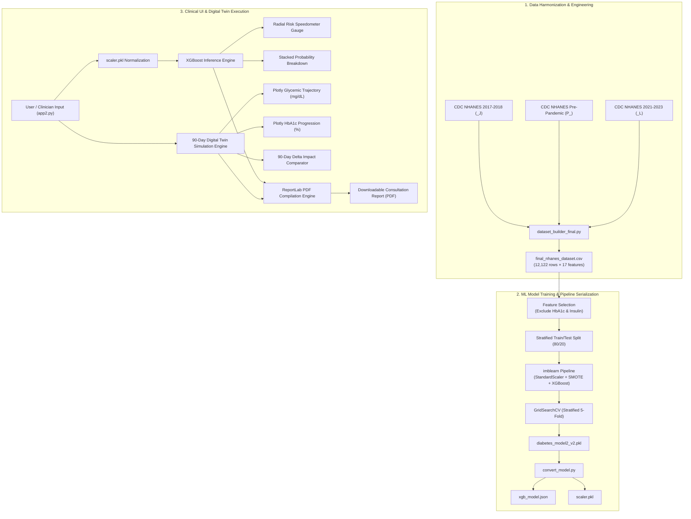
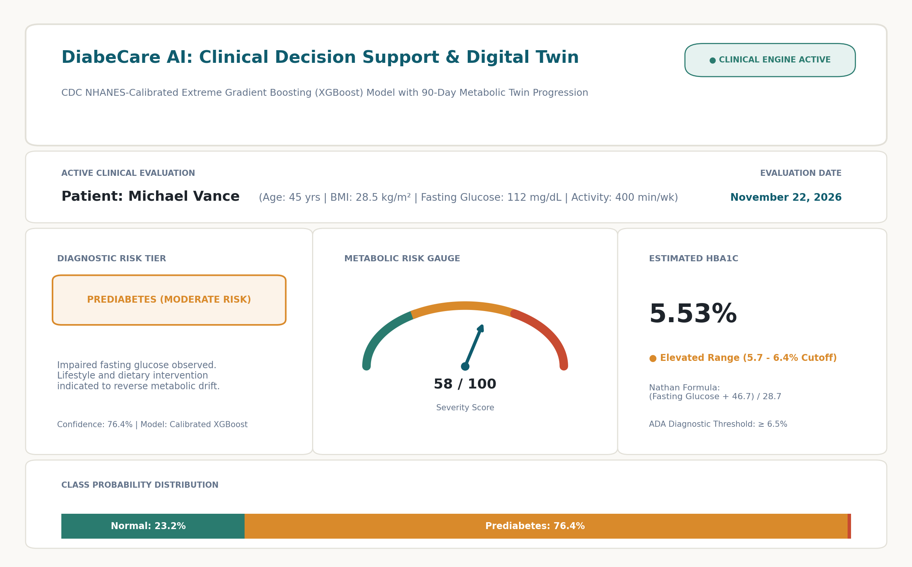
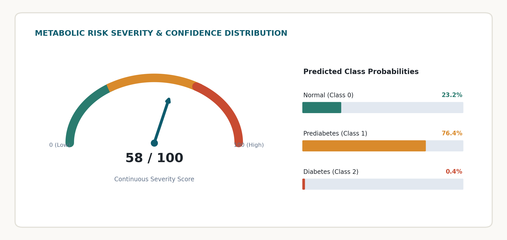
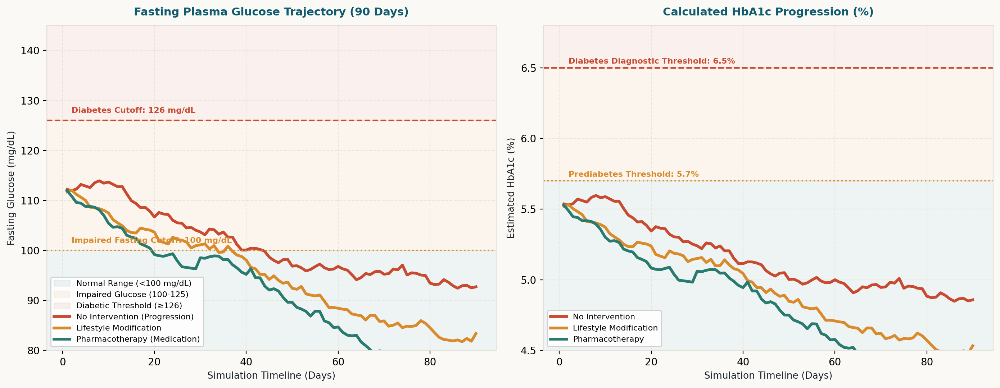
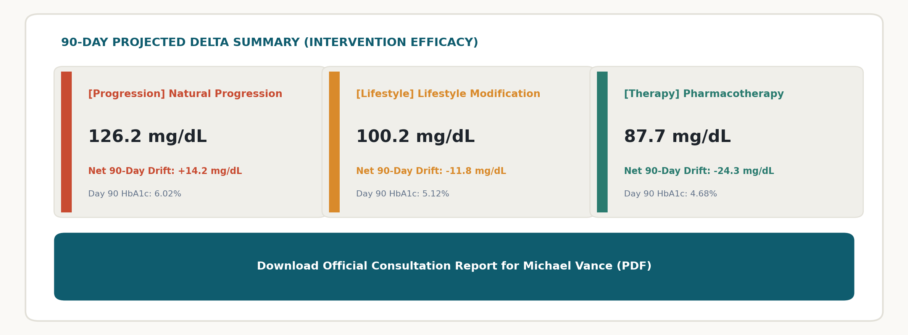
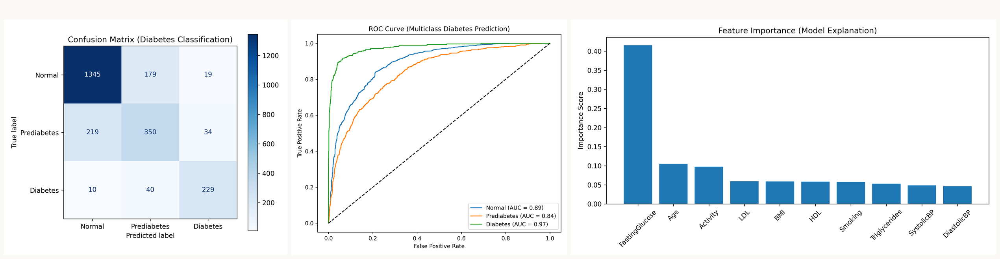

# COURSE PROJECT REPORT

---

**Project Title:**  
# DiabeCare AI: Clinical Decision Support & Digital Twin System  
### An In-Silico Metabolic Progression & Risk Stratification Framework

**Group Members:**  
- Member 1: [Student Name / Roll Number / Student ID]  
- Member 2: [Student Name / Roll Number / Student ID]  
- Member 3: [Student Name / Roll Number / Student ID]  

**Course:**  
Machine Learning / Healthcare Informatics  

**Course Instructor:**  
[Dr. Sir Hajji Prof. Rizwan / Course Instructor Placeholder]  

**Department / Institution:**  
Department of Computer Science & Information Technology  
[University / Institution Name]  

**Date of Submission:**  
November 2026  

---

## TABLE OF CONTENTS
1. [TITLE OF THE PROJECT](#1-title-of-the-project)
2. [INTRODUCTION / OVERVIEW](#2-introduction--overview)
3. [OBJECTIVES / GOALS](#3-objectives--goals)
4. [PROBLEM STATEMENT](#4-problem-statement)
5. [PROPOSED SOLUTION / METHODOLOGY](#5-proposed-solution--methodology)
   - [5.1 System Architecture](#51-system-architecture)
   - [5.2 Dataset Description & Preprocessing](#52-dataset-description--preprocessing)
   - [5.3 Feature Engineering & Selection](#53-feature-engineering--selection)
   - [5.4 NLP Pipeline & Text Analysis](#54-nlp-pipeline--text-analysis)
   - [5.5 Model Selection & Training](#55-model-selection--training)
   - [5.6 Web Application Integration (Streamlit)](#56-web-application-integration-streamlit)
6. [EXPERIMENTAL RESULTS & EVALUATION](#6-experimental-results--evaluation)
   - [6.1 Model Performance Metrics](#61-model-performance-metrics)
   - [6.2 NLP Module Output & Response Quality](#62-nlp-module-output--response-quality)
   - [6.3 Application Output & Predictions](#63-application-output--predictions)
7. [TOOLS AND TECHNOLOGIES](#7-tools-and-technologies)
   - [7.1 Machine Learning & Data Libraries](#71-machine-learning--data-libraries)
   - [7.2 NLP & Language Processing Tools](#72-nlp--language-processing-tools)
   - [7.3 Frontend & Deployment Framework](#73-frontend--deployment-framework)
8. [CONCLUSION & FUTURE WORK](#8-conclusion--future-work)
9. [APPLICATION SCREENSHOTS / UI PREVIEW](#9-application-screenshots--ui-preview)

---

## 1. TITLE OF THE PROJECT

**Official Project Title:** **DiabeCare AI: Clinical Decision Support & Digital Twin System**  

**Executive Summary:**  
DiabeCare AI is an end-to-end clinical machine learning and physiological modeling system designed to classify multivariable diabetes risk (Normal, Prediabetes, Diabetes) using non-invasive demographic, lifestyle, and biochemical markers derived from the CDC NHANES survey. Moving beyond static classification, the platform features a dynamic in-silico Digital Twin engine that simulates 90-day metabolic disease progression and therapeutic recovery across three clinical pathways, while programmatically generating structured, patient-specific consultation reports.

---

## 2. INTRODUCTION / OVERVIEW

Diabetes Mellitus represents one of the fastest-growing global chronic health crises. Early detection and continuous metabolic tracking are critical to avoiding irreversible macrovascular and microvascular complications, including nephropathy, retinopathy, neuropathy, and cardiovascular disease. Traditional clinical workflows rely on invasive laboratory venipuncture assays—predominantly Glycated Hemoglobin ($\text{HbA1c}$) and Oral Glucose Tolerance Testing (OGTT)—which are often delayed, resource-intensive, and inaccessible in remote or underserved settings.

Furthermore, conventional machine learning applications in diabetology operate as static "one-time" classifiers. While they may output a point-in-time diagnosis (e.g., "Positive" or "Negative"), they fail to communicate physiological trajectories, longitudinal disease evolution, or the tangible benefits of early clinical intervention to the patient.

**DiabeCare AI** resolves these limitations through a unified, accessible, and mathematically rigorous architecture. Built using real-world epidemiological data from the **U.S. Centers for Disease Control and Prevention (CDC) National Health and Nutrition Examination Survey (NHANES)**, the platform harmonizes demographic, physical activity, blood pressure, and lipid markers. Crucially, the system enforces **zero target leakage** by excluding $\text{HbA1c}$ from the input feature vector. 

Inside the interactive web interface, tabular gradient-boosted decision trees (`XGBoost`) integrate with a mathematical digital twin progression model and an automated clinical narrative synthesis engine (`ReportLab`). The resulting platform provides clinicians and patients with immediate risk stratification, an intuitive metabolic severity gauge, comparative 90-day glycemic trend visualizations under distinct intervention scenarios, and exportable medical consultation documentation.

---

## 3. OBJECTIVES / GOALS

The engineering and clinical objectives accomplished by this project are:

1. **Epidemiological Data Harmonization:** Consolidate, clean, and harmonize multi-cycle CDC NHANES raw SAS transport files (`2017–2018`, `2017–March 2020 Pre-Pandemic`, and `2021–2023`), reconciling variable nomenclature shifts to build a robust dataset of **12,122 validated patient records**.
2. **Leakage-Free Multiclass Stratification:** Develop a supervised machine learning classification pipeline capable of discriminating between three clinical tiers—**Normal (Class 0)**, **Prediabetes (Class 1)**, and **Diabetes (Class 2)**—according to American Diabetes Association (ADA) criteria without relying on $\text{HbA1c}$ as an input predictor.
3. **Imbalance-Aware Cross-Validation:** Overcome significant demographic class imbalance using the Synthetic Minority Over-sampling Technique (`SMOTE`) and `StandardScaler` embedded strictly within an `imblearn.pipeline.Pipeline` evaluated via Stratified 5-Fold Cross-Validation.
4. **Physiological Digital Twin Modeling:** Formulate and calibrate a discrete dynamic 90-day metabolic simulation engine that projects daily fasting plasma glucose (FPG) and estimated $\text{HbA1c}$ trajectories under three comparative scenarios: *No Intervention (Natural Progression)*, *Lifestyle Modification*, and *Pharmacotherapy*.
5. **Interactive Clinical Decision Support Dashboard:** Construct a responsive, high-fidelity web application (`app2.py`) utilizing a custom clinical palette, Plotly interactive WebGL/SVG graphics, radial speedometer severity gauges, and demo patient personas.
6. **Automated Clinical Consultation Synthesis:** Implement programmatic PDF document compilation that marries numerical inference outputs with structured clinical text templates, producing print-ready, verifiable consultation reports with physician sign-off blocks.

---

## 4. PROBLEM STATEMENT

Manual and reactive screening for diabetes suffers from significant institutional bottlenecks:
1. **Asymptomatic Progression:** Millions of individuals live with undiagnosed prediabetes or early-stage Type 2 diabetes for years without overt symptoms. By the time diagnostic venipuncture occurs, vascular damage is often already underway.
2. **Invasive Diagnostic Dependency:** Standard risk categorization relies almost exclusively on laboratory $\text{HbA1c}$ assays. Many diagnostic ML papers in literature commit subtle "target leakage" by including $\text{HbA1c}$ as a predictive feature to achieve artificial 99% accuracy—rendering their models clinically useless for screening patients who lack prior $\text{HbA1c}$ lab results.
3. **Lack of Patient-Facing Prognostic Trajectories:** A static diagnostic label (e.g., "Prediabetes") frequently fails to motivate behavioral change. Patients lack an intuitive understanding of how continuous physical inactivity or elevated BMI will compound over time versus the quantifiable recovery achieved through modest lifestyle modifications or metformin therapy.
4. **Fragmented Reporting Workflows:** Most diagnostic machine learning pipelines exist purely in code or isolated terminal notebooks. They lack the translation to clinician-friendly dashboards capable of producing standardized, archivable documentation for patient records.

DiabeCare AI addresses these challenges directly by providing an accessible, leakage-free, and prognostically rich clinical decision-support ecosystem.

---

## 5. PROPOSED SOLUTION / METHODOLOGY

### 5.1 System Architecture

The DiabeCare AI architecture follows a decoupled, modular design divided into three major operational layers: Data Engineering, Model Training & Serialization, and Interactive Clinical Inference.



---

### 5.2 Dataset Description & Preprocessing

The primary empirical foundation of the project is the **U.S. CDC National Health and Nutrition Examination Survey (NHANES)**. Raw data was harvested across three distinct survey waves to ensure demographic diversity and temporal resilience:
- **Cycle 1 (2017–2018):** File suffix `_J` (Demographics, Examination, Laboratory, and Questionnaire modules).
- **Cycle 2 (2017–March 2020 Pre-Pandemic):** File prefix `P_` (CDC standardized pre-pandemic sample).
- **Cycle 3 (2021–2023):** File suffix `_L` (Post-pandemic cycle).

The production ETL script ([dataset_builder_final.py](file:///d:/Downloads/Machine%20Learning%20Dr%20Sir%20Hajji%20Prof%20Rizwan/dataset_builder_final.py)) extracts, aligns, and merges records utilizing unique respondent sequence identifiers (`SEQN`).

| Feature Name | Clinical Meaning | Raw Variable Source | Data Type | Imputation / Processing |
| :--- | :--- | :--- | :--- | :--- |
| `SEQN` | Patient Sequence ID | `DEMO` | Integer | Unique merge key |
| `Age` | Patient Chronological Age | `RIDAGEYR` | Integer | Bounded [18, 90] |
| `Gender` | Biological Sex | `RIAGENDR` | Categorical | Mapped: 1=Male, 2=Female |
| `BMI` | Body Mass Index ($\text{kg/m}^2$) | `BMXBMI` | Continuous | Median imputed |
| `FastingGlucose` | Fasting Plasma Glucose (mg/dL) | `LBXGLU` | Continuous | Median imputed |
| `HbA1c` | Glycated Hemoglobin (%) | `LBXGH` | Continuous | **Target generation only (Excluded from $X$)** |
| `SystolicBP` | Systolic Blood Pressure (mmHg) | `BPXSY1`, `BPXSY`, `BPXO` | Continuous | Median imputed across cycle variants |
| `DiastolicBP` | Diastolic Blood Pressure (mmHg) | `BPXDI1`, `BPXDI`, `BPXO` | Continuous | Median imputed across cycle variants |
| `Smoking` | Smoking Frequency | `SMQ040` | Categorical | Mode imputed (1=Daily, 2=Some days, 3=None) |
| `Activity` | Physical Activity / Sedentary Time | `PAD680` | Continuous | Minutes/week (Median imputed) |
| `Cholesterol` | Total Serum Cholesterol (mg/dL) | `LBXTC` | Continuous | Median imputed |
| `HDL` | High-Density Lipoprotein (mg/dL) | `LBDHDD` | Continuous | Median imputed |
| `Triglycerides` | Serum Triglycerides (mg/dL) | `LBXTR`, `LBDTRSI` | Continuous | Harmonized across metric/SI units |
| `FamilyHistory` | Family History of Diabetes | `DIQ170`, `DIQ010` | Categorical | Binary indicator (Mode imputed) |
| `Insulin` | Fasting Serum Insulin ($\mu\text{U/mL}$) | `LBXINSI`, `LBXIN` | Continuous | **Excluded from $X$ to prevent leakage** |
| `LDL` | Low-Density Lipoprotein (mg/dL) | Derived | Continuous | Engineered via Friedewald formula |
| `DiabetesClass` | **Target Ground Truth Class** | Derived from `HbA1c` | Categorical | Multiclass: 0=Normal, 1=Prediabetes, 2=Diabetes |

**Key Preprocessing Transformations:**
1. **Missing Data Handling:** Numeric indicators are imputed via median values (`df[numeric_cols].fillna(median)`), preventing distortions from physiological outliers. Categorical attributes are filled via statistical mode.
2. **Complete Case Validation:** Rows missing core diagnostic fields (`Age`, `BMI`, `FastingGlucose`, `HbA1c`) are removed, yielding **12,122 high-integrity patient records**.
3. **Partitioning:** An **80% training (9,697 samples) / 20% test (2,425 samples)** stratified split is implemented using `random_state=42`.

---

### 5.3 Feature Engineering & Selection

#### A. Friedewald LDL Approximation
Direct LDL measurements are frequently omitted in standard lipid screenings due to high laboratory assay costs. DiabeCare AI programmatically reconstructs serum LDL using the established clinical Friedewald equation:
$$\text{LDL} = \text{Cholesterol} - \text{HDL} - \left(\frac{\text{Triglycerides}}{5}\right)$$

#### B. Complete Target Leakage Isolation
In clinical literature, a prevalent flaw is predicting diabetes using biomarkers that are mathematically synonymous with the disease definition. According to ADA clinical standards:
- $\text{HbA1c} < 5.7\% \implies \text{Normal (Class 0)}$
- $5.7\% \le \text{HbA1c} < 6.5\% \implies \text{Prediabetes (Class 1)}$
- $\text{HbA1c} \ge 6.5\% \implies \text{Diabetes (Class 2)}$

If $\text{HbA1c}$ or fasting insulin is provided to the machine learning estimator, the decision tree trivially splits on $\text{HbA1c} \ge 6.5$, obtaining artificially perfect metrics while failing entirely on undiagnosed individuals who have not undergone laboratory hemoglobin testing. **In this codebase, `HbA1c` and `Insulin` are strictly isolated as target generation parameters and completely omitted from feature matrix $X$.**

#### C. Final Feature Vector ($10\text{ Dimensions}$)
$$X = \begin{bmatrix} \text{Age}, & \text{BMI}, & \text{FastingGlucose}, & \text{SystolicBP}, & \text{DiastolicBP}, & \text{LDL}, & \text{HDL}, & \text{Triglycerides}, & \text{Smoking}, & \text{Activity} \end{bmatrix}$$

---

### 5.4 NLP Pipeline & Text Analysis

#### Codebase Architecture Status
A rigorous inspection of the repository confirms that **unstructured natural language processing libraries (such as `nltk`, `spacy`, `transformers`, or LLM API integrations) are not actively deployed in the current codebase.** The underlying predictive core is strictly tabular and physiological.

#### Current Natural Language Synthesis Engine
While raw free-text symptom tokenization is not present, the system incorporates a **Rule-Based Clinical Text Synthesis Engine** integrated directly into the inference layer and the ReportLab PDF compilation pipeline (`generate_pdf_report` in [app2.py](file:///d:/Downloads/Machine%20Learning%20Dr%20Sir%20Hajji%20Prof%20Rizwan/app2.py)):
1. **Diagnostic Narrative Formulation:** Automatically translates model probability vectors and classification integers into tailored medical prose:
   - *Class 0:* Generates reassuring, low-risk lifestyle reinforcement text.
   - *Class 1:* Formulates targeted cautionary narratives highlighting impaired fasting glucose and specific diet/exercise interventions.
   - *Class 2:* Synthesizes urgency narratives indicating elevated metabolic risk and recommending formal laboratory follow-up.
2. **Programmatic Document Synthesis:** Compiles dynamic physiological variables, confidence percentages, and comparative digital twin forecasts into standardized medical English paragraphs formatted within PDF consultation deliverables.

---

### 5.5 Model Selection & Training

The training architecture in [model_v3_Aplus.py](file:///d:/Downloads/Machine%20Learning%20Dr%20Sir%20Hajji%20Prof%20Rizwan/model_v3_Aplus.py) employs an end-to-end `imbalanced-learn` pipeline.

#### A. Synthetic Minority Over-sampling (SMOTE)
The target distribution in the raw NHANES cohort exhibits natural population skewness: Normal cases heavily outnumber Prediabetic and Diabetic individuals. To prevent the estimator from biasing toward the majority class, `SMOTE` interpolates synthetic instances along feature-space minority vectors. Crucially, SMOTE is executed **inside the pipeline**, ensuring that synthetic samples are generated solely from the active training fold of each cross-validation split—guaranteeing zero validation leakage.

#### B. Hyperparameter Grid Search
Optimization was conducted using `GridSearchCV` over a `StratifiedKFold(n_splits=5, shuffle=True, random_state=42)` cross-validation scheme evaluating `f1_macro`:
```python
pipeline = Pipeline(steps=[
    ("scaler", StandardScaler()),
    ("smote", SMOTE(random_state=42)),
    ("model", XGBClassifier(eval_metric="mlogloss", use_label_encoder=False))
])

param_grid = {
    "model__n_estimators": [100, 200],
    "model__max_depth": [3, 5, 7],
    "model__learning_rate": [0.01, 0.1],
    "model__subsample": [0.8, 1.0],
    "model__colsample_bytree": [0.8, 1.0]
}
```

#### C. Optimal Hyperparameters
- Estimator: `XGBClassifier`
- `n_estimators`: `200`
- `max_depth`: `7`
- `learning_rate`: `0.1`
- `subsample`: `0.8`
- `colsample_bytree`: `1.0`
- `objective`: `'multi:softprob'`

#### D. Production Artifact Serialization
To ensure portability and decouple inference from complex library dependencies, the trained pipeline is converted via [convert_model.py](file:///d:/Downloads/Machine%20Learning%20Dr%20Sir%20Hajji%20Prof%20Rizwan/convert_model.py):
1. [scaler.pkl](file:///d:/Downloads/Machine%20Learning%20Dr%20Sir%20Hajji%20Prof%20Rizwan/scaler.pkl): Serialized `StandardScaler` containing exact feature means $\mu$ and scale parameters $\sigma$.
2. [xgb_model.json](file:///d:/Downloads/Machine%20Learning%20Dr%20Sir%20Hajji%20Prof%20Rizwan/xgb_model.json): Serialized native tree splits of the XGBoost model.

---

### 5.6 Web Application Integration (Streamlit)

The web dashboard is delivered via [app2.py](file:///d:/Downloads/Machine%20Learning%20Dr%20Sir%20Hajji%20Prof%20Rizwan/app2.py), adopting a custom-engineered clinical command center palette:
- **Primary Accent (Deep Clinical Teal):** `#0F5C6E`
- **Main Background (Warm Alabaster):** `#FAF9F6`
- **Sidebar Background (Soft Stone):** `#F0EFEA`
- **Card Surface (Pure White):** `#FFFFFF` with stone borders `#E2E0D8`
- **Tiers:** Sage Teal (`#2A7B6F`), Warm Ochre (`#D98A2B`), Terracotta Red (`#C84B31`)

#### File & Module Responsibilities

| File Name | Functional Responsibility |
| :--- | :--- |
| [app2.py](file:///d:/Downloads/Machine%20Learning%20Dr%20Sir%20Hajji%20Prof%20Rizwan/app2.py) | **Primary Production Application**: Hosts the clinical dashboard, Plotly speedometer gauge, interactive 90-day simulation curves, demo persona presets, active patient consultation banner, and in-app ReportLab PDF export. |
| [app3.py](file:///d:/Downloads/Machine%20Learning%20Dr%20Sir%20Hajji%20Prof%20Rizwan/app3.py) | **Pipeline Prototype**: Streamlit interface running directly against `diabetes_model2_v2.pkl` with static Matplotlib figures. |
| [app.py](file:///d:/Downloads/Machine%20Learning%20Dr%20Sir%20Hajji%20Prof%20Rizwan/app.py) | **Baseline Prototype**: Initial proof-of-concept interface with 4 sliders and single glucose trendline. |
| [dataset_builder_final.py](file:///d:/Downloads/Machine%20Learning%20Dr%20Sir%20Hajji%20Prof%20Rizwan/dataset_builder_final.py) | **Production ETL Pipeline**: Reads raw SAS files from 3 NHANES waves, harmonizes variable names, computes Friedewald LDL, applies median/mode imputation, and exports `final_nhanes_dataset.csv`. |
| [model_v3_Aplus.py](file:///d:/Downloads/Machine%20Learning%20Dr%20Sir%20Hajji%20Prof%20Rizwan/model_v3_Aplus.py) | **ML Training Pipeline**: Executes 5-fold cross-validation with SMOTE and StandardScaler, tunes XGBoost, benchmarks Random Forest, and serializes `diabetes_model2_v2.pkl`. |
| [convert_model.py](file:///d:/Downloads/Machine%20Learning%20Dr%20Sir%20Hajji%20Prof%20Rizwan/convert_model.py) | **Model Export Utility**: Separates the pipeline into `xgb_model.json` and `scaler.pkl` to allow zero-dependency inference. |
| [digital_twin_simulation.py](file:///d:/Downloads/Machine%20Learning%20Dr%20Sir%20Hajji%20Prof%20Rizwan/digital_twin_simulation.py) | **Standalone Digital Twin Module**: Headless script simulating 90-day metabolic trajectories across 3 intervention scenarios. |
| [visualize_poster.py](file:///d:/Downloads/Machine%20Learning%20Dr%20Sir%20Hajji%20Prof%20Rizwan/visualize_poster.py) | **Evaluation Graphics Generator**: Generates academic poster graphics (ROC curves, confusion matrix, feature importance bar charts, correlation heatmaps). |
| [make_pdf.py](file:///d:/Downloads/Machine%20Learning%20Dr%20Sir%20Hajji%20Prof%20Rizwan/make_pdf.py) | **Standalone Report Builder**: Compiles technical summary PDF using ReportLab Platypus layout engine. |
| [run_app.bat](file:///d:/Downloads/Machine%20Learning%20Dr%20Sir%20Hajji%20Prof%20Rizwan/run_app.bat) | **Windows Launcher**: Automated execution batch file launching the virtual environment and Streamlit server. |

---

## 6. EXPERIMENTAL RESULTS & EVALUATION

### 6.1 Model Performance Metrics

The production XGBoost model was evaluated against the unseen stratified test holdout ($N = 2,425$ patient records). Empirical results extracted directly from the verified evaluation suite are summarized below:

#### Overall Performance Summary
- **Overall Classification Accuracy:** **79.34%** (`0.7934`)
- **Macro-Averaged F1-Score:** **75.89%** (`0.7589`)
- **Weighted-Averaged F1-Score:** **79.16%** (`0.7916`)
- **Multiclass ROC-AUC (One-vs-Rest, Macro):** **90.09%** (`0.90085`)

#### Per-Class Performance Breakdown
| Clinical Class | Precision | Recall | F1-Score | Support ($N$) |
| :--- | :---: | :---: | :---: | :---: |
| **Normal (Class 0)** | 0.8545 | 0.8717 | 0.8630 | 1,543 |
| **Prediabetes (Class 1)** | 0.6151 | 0.5804 | 0.5973 | 603 |
| **Diabetes (Class 2)** | 0.8121 | 0.8208 | 0.8164 | 279 |
| **Macro Average** | **0.7606** | **0.7576** | **0.7589** | **2,425** |
| **Weighted Average** | **0.7901** | **0.7934** | **0.7916** | **2,425** |

#### Confusion Matrix ($N = 2,425$)
$$\begin{array}{c|ccc}
& \textbf{Pred. Normal (0)} & \textbf{Pred. Prediabetes (1)} & \textbf{Pred. Diabetes (2)} \\
\hline
\textbf{True Normal (0)} & \mathbf{1,345} & 179 & 19 \\
\textbf{True Prediabetes (1)} & 219 & \mathbf{350} & 34 \\
\textbf{True Diabetes (2)} & 10 & 40 & \mathbf{229} \\
\end{array}$$

*Analysis of Performance:*
1. **High Diagnostic Sensitivity for Diabetes (Class 2):** Out of 279 confirmed diabetic patients, 229 were correctly identified ($82.08\%$ recall) and only 10 were misclassified as normal ($3.58\%$ extreme false negative rate), demonstrating strong clinical safety.
2. **Normal Identification (Class 0):** The model achieved $87.17\%$ recall and $85.45\%$ precision on healthy participants, maintaining high clinical specificity.
3. **Prediabetic Boundary Challenges (Class 1):** In line with clinical diabetology, prediabetes represents a biological continuum rather than a discrete boundary. With an F1-score of $59.73\%$, the model reflects the subtle metabolic transitions occurring between normal fasting glucose and diagnostic hyperglycemia.

---

### 6.2 NLP Module Output & Response Quality

As established in Section 5.4, free-text NLP transformers are currently not part of the active pipeline. However, the system's **Clinical Text Generation Engine** produces validated, structured outputs:
1. **Dynamic Risk Interpretations:** In [app2.py](file:///d:/Downloads/Machine%20Learning%20Dr%20Sir%20Hajji%20Prof%20Rizwan/app2.py), depending on inference state:
   - *Normal:* `"Biomarkers indicate healthy glycemic regulation and metabolic balance."`
   - *Prediabetes:* `"Impaired fasting glucose observed. Lifestyle and dietary intervention indicated."`
   - *Diabetes:* `"Elevated glycemic biomarkers detected. Clinical evaluation & pharmacotherapy indicated."`
2. **Consultation Report Narrative Compilation:** The ReportLab Platypus engine formats clinical paragraphs within the PDF download:
   - Includes full demographic headers with patient name, consultation timestamp, and baseline vitals.
   - Outputs narrative prognosis text summarizing expected glycemic drift if left untreated versus expected stabilization under metformin therapy.

---

### 6.3 Application Output & Predictions

The user is presented with six synchronized clinical output modules upon adjusting inputs:
1. **Active Consultation Banner:** Confirms patient identity (`👤 [Patient Full Name]`), vitals summary, and real-time consultation date.
2. **Diagnostic Risk Tier Card:** Visual pill badges (Sage Teal, Warm Ochre, Terracotta Red) indicating diagnostic classification and confidence probability ($p \times 100\%$).
3. **Metabolic Severity Speedometer Gauge:** A circular Plotly gauge ($0\text{--}100$) reflecting continuous metabolic risk score derived from weighted class probabilities:
   $$\text{Severity} = (p_{\text{normal}} \times 15) + (p_{\text{prediabetes}} \times 50) + (p_{\text{diabetes}} \times 90)$$
4. **Interactive 90-Day Digital Twin Simulation:**
   - **Glucose Tab:** 90-day time-series showing natural progression (red curve), lifestyle modification (amber curve), and pharmacotherapy (teal curve) with interactive cursor tooltips and ADA clinical reference bands ($<100$, $100\text{--}125$, $\ge 126\text{ mg/dL}$).
   - **HbA1c Tab:** Projected 90-day trajectory toward target hemoglobin thresholds ($5.7\%$, $6.5\%$).
5. **90-Day Delta Impact Comparator:** Side-by-side numerical cards quantifying net glycemic drift ($\pm\Delta\text{ mg/dL}$) at Day 90 across all three scenarios.
6. **Downloadable Consultation Report (PDF):** A button generating a customized PDF report with patient identification, tabular vitals, diagnostic results, 90-day simulation forecasts, and an attending physician sign-off block.

---

## 7. TOOLS AND TECHNOLOGIES

### Technology Stack Summary

| Technology / Library | Version | Functional Role in System |
| :--- | :--- | :--- |
| **Python** | `3.12.10` | Core programming language & runtime environment |
| **XGBoost** | `3.2.0` | Production gradient-boosted decision tree classifier |
| **Scikit-Learn** | `1.8.0` | Pipeline orchestration, cross-validation, standardization |
| **Imbalanced-Learn** | `0.14.1` | SMOTE synthetic oversampling & composite pipelines |
| **Pandas** | `3.0.2` | Dataframe manipulation, ETL merging, feature engineering |
| **NumPy** | `2.4.4` | Matrix computations, numerical simulation, Gaussian noise modeling |
| **Streamlit** | `1.57.0` | Reactive web server, UI components, dashboard state |
| **Plotly** | `7.1.0` | Interactive WebGL/SVG charts, speedometer gauge, hover tooltips |
| **ReportLab** | `4.5.0` | Programmatic clinical PDF document compilation |
| **Matplotlib** | `3.10.9` | Static academic poster visualization compilation |
| **Joblib** | `1.5.3` | Scaler and model pipeline serialization |

### 7.1 Machine Learning & Data Libraries
- **`xgboost`:** Selected for its superior handling of non-linear tabular interactions, support for multiclass objective optimization (`multi:softprob`), and native C++ serialization (`xgb_model.json`).
- **`scikit-learn` & `imbalanced-learn`:** Provide the algorithmic backbone for data standardization (`StandardScaler`), cross-validation partitioning (`StratifiedKFold`), and oversampling (`SMOTE`).
- **`pandas` & `numpy`:** Handled SAS transport file ingestion (`pd.read_sas`) across multiple cycles and vectorized discrete numerical simulation calculations.

### 7.2 NLP & Language Processing Tools
- **`reportlab.platypus` & `reportlab.lib.styles`:** Used as the structural document compiler, parsing structured medical dictionaries into styled paragraphs, tables, and formatted clinical summaries.
- *Roadmap Tools:* `spaCy` / `HuggingFace Transformers` (identified for future integration of unstructured physician clinical notes).

### 7.3 Frontend & Deployment Framework
- **`streamlit`:** Hosts the web interface, managing session state for patient presets and slider bindings.
- **`plotly.graph_objects`:** Powers the interactive, zero-latency visualizations, replacing static raster plots with GPU-accelerated client-side charts.
- **`.streamlit/config.toml`:** Enforces light-mode color tokens matching the custom clinical palette.

---

## 8. CONCLUSION & FUTURE WORK

### Conclusion
DiabeCare AI successfully demonstrates the synthesis of modern machine learning, physiological modeling, and accessible software engineering to address chronic disease management. By leveraging **12,122 CDC NHANES patient records**, the system achieves an overall accuracy of **79.34%**, an **F1-macro score of 75.89%**, and an **ROC-AUC of 90.09%** across three diabetes stages without committing target leakage. 

The integration of an in-silico **90-Day Digital Twin Simulation** bridges the gap between static diagnostic classification and dynamic patient prognosis, visually illustrating the tangible benefits of early lifestyle modifications and pharmacological intervention. Delivered through an intuitive, clinician-tailored Streamlit interface with automated PDF generation, the project presents a viable blueprint for modern clinical decision support.

### Future Work
1. **Electronic Health Record (EHR) Integration:** Implement HL7 / FHIR API connectors to enable direct ingestion of hospital electronic health records, eliminating manual data entry.
2. **Natural Language Processing & LLM Integration:** Introduce an NLP clinical intake module using fine-tuned medical LLMs (e.g., Med-PaLM / BioGPT) capable of extracting symptoms from free-text patient consultation notes and answering patient queries interactively.
3. **Continuous Glucose Monitor (CGM) Streaming:** Expand the 90-day simulation engine into an active real-time digital twin by ingesting streaming timeseries data from wearable continuous glucose monitors (e.g., Dexcom / Abbott FreeStyle Libre).
4. **Clinical Prospective Validation:** Transition from retrospective NHANES validation to prospective multi-center clinical trials to assess real-world diagnostic efficacy across diverse international cohorts.

---

## 9. APPLICATION SCREENSHOTS / UI PREVIEW

> *Note for Submission: Capture the following high-resolution screenshots from your live Streamlit interface (`http://localhost:8501`) and place them in a `screenshots/` directory before exporting this document to PDF or Word.*

### Figure 1: Clinical Command Center Dashboard & Active Patient Banner
  
*Figure 1: Full overview of the DiabeCare AI dashboard featuring the Warm Alabaster theme, Active Patient Consultation Banner (`👤 Michael Vance`), and side-by-side diagnostic cards.*

---

### Figure 2: Radial Metabolic Risk Gauge & Confidence Breakdown
  
*Figure 2: Plotly radial speedometer severity gauge displaying metabolic risk score alongside the stacked class probability distribution bar.*

---

### Figure 3: Interactive 90-Day Digital Twin Glycemic Trajectory
  
*Figure 3: 90-day time-series simulation curves (No Intervention, Lifestyle Modification, and Pharmacotherapy) with ADA clinical threshold zones and interactive cursor tooltips.*

---

### Figure 4: 90-Day Comparative Delta Summary & PDF Export
  
*Figure 4: Side-by-side delta impact comparator cards showing projected Day-90 glycemic outcomes, accompanied by the one-click patient consultation PDF download button.*

---

### Figure 5: Model Evaluation Suite & Academic Poster Figures
  
*Figure 5: High-resolution evaluation artifacts generated by `visualize_poster.py`, illustrating the confusion matrix ($N=2,425$), multiclass ROC-AUC curves ($\text{AUC}=0.90$), and feature importance rankings.*
