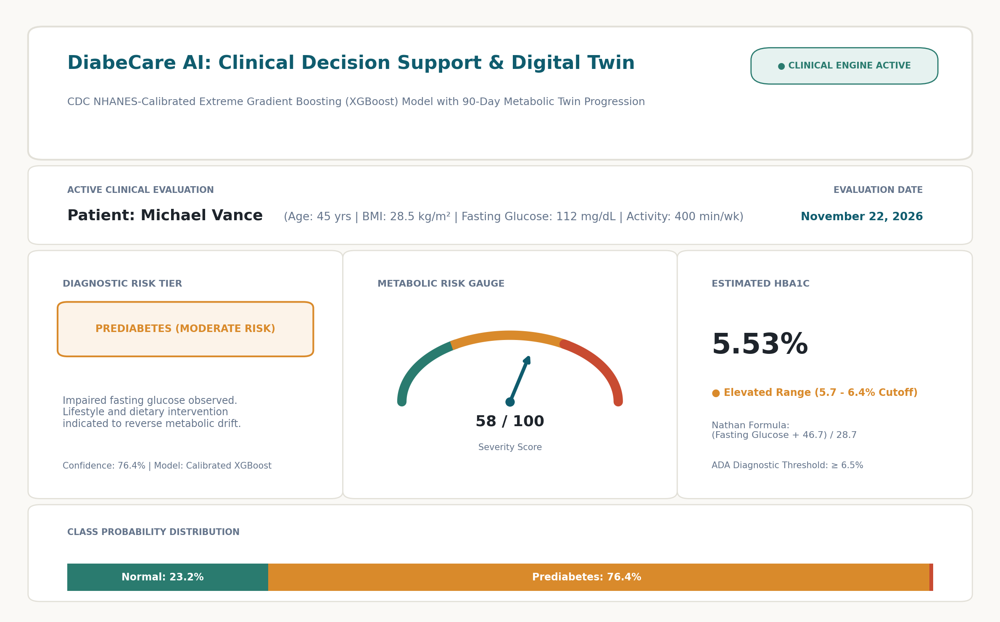
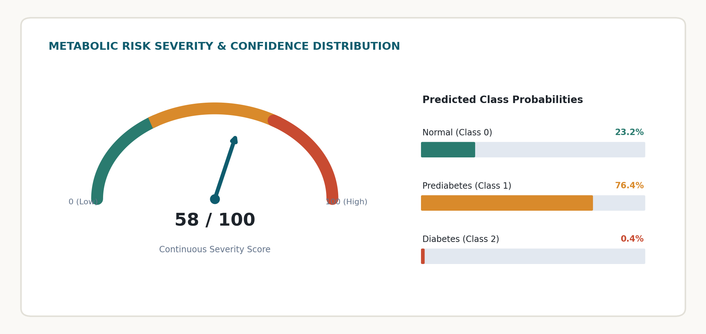
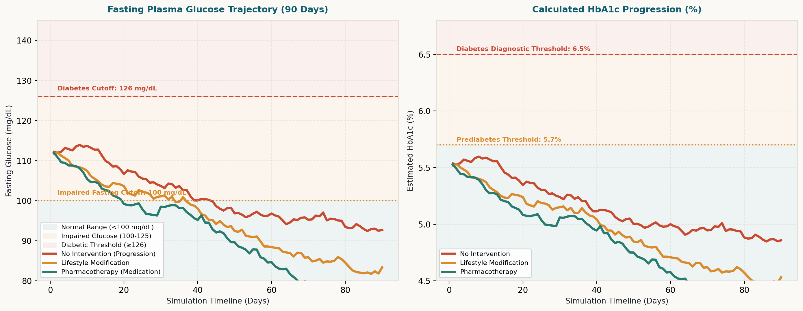
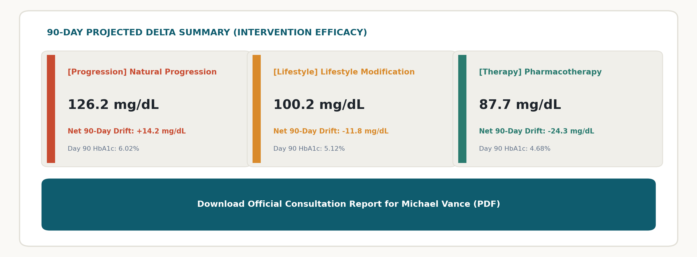
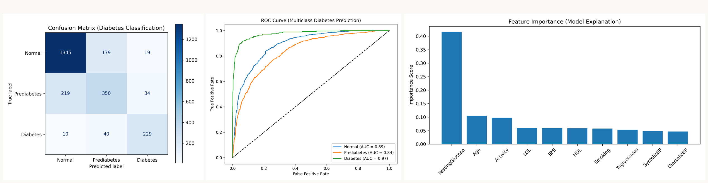
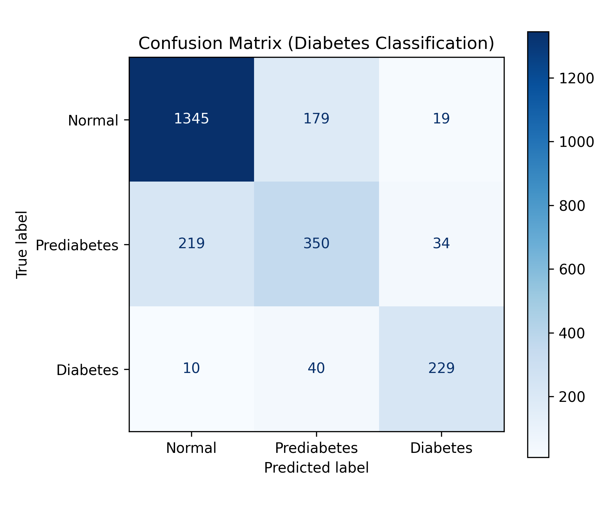
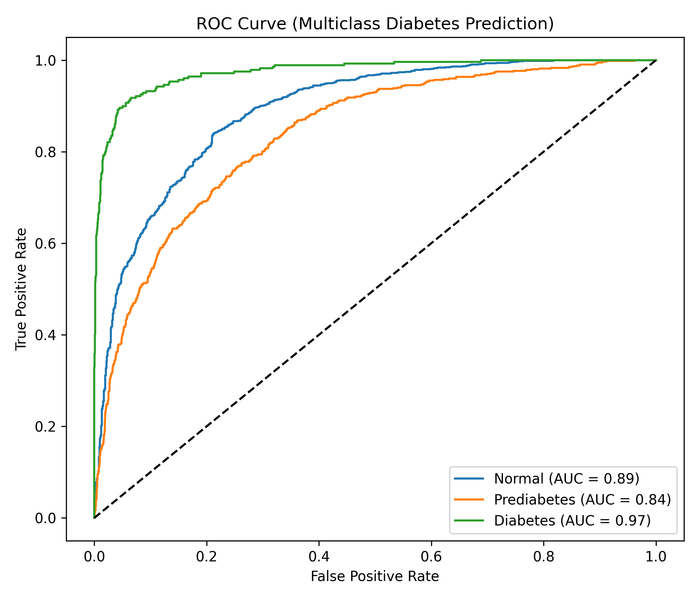
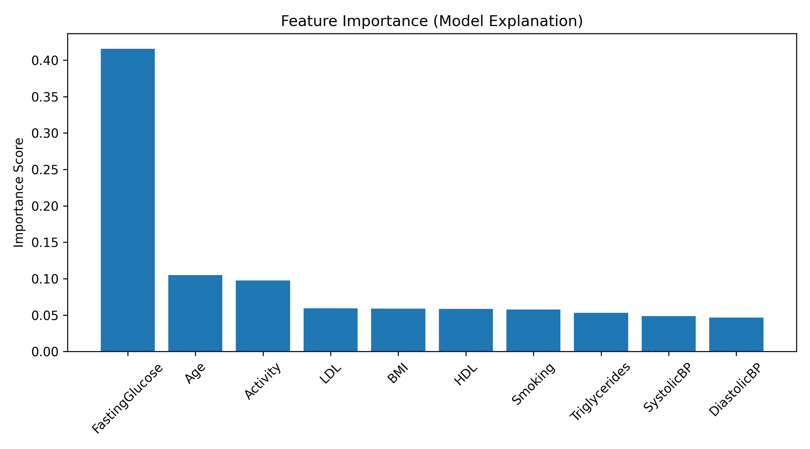
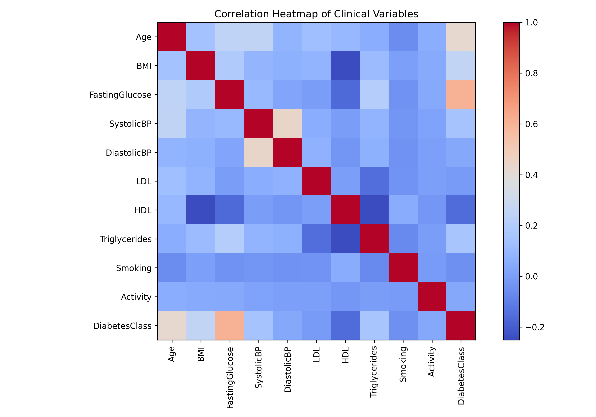

# 🩺 DiabeCare AI — Clinical Risk Assessment & Digital Twin System

> **An In-Silico Metabolic Progression & Multiclass Diabetes Risk Stratification Framework**  
> Powered by Machine Learning, CDC NHANES Epidemiological Data, and 90-Day Digital Twin Glycemic Trajectory Simulation.

[](https://diabecare-ai-ljj2xuxftx5ahzetpfzkwj.streamlit.app/)
[](https://www.python.org/)
[](https://xgboost.readthedocs.io/)
[](https://scikit-learn.org/)
[](LICENSE)

---

## 🌐 Live Web Application

Experience the full interactive clinical decision-support platform live in your browser:  
👉 **[https://diabecare-ai-ljj2xuxftx5ahzetpfzkwj.streamlit.app/](https://diabecare-ai-ljj2xuxftx5ahzetpfzkwj.streamlit.app/)**

---

## 📌 Executive Summary

**DiabeCare AI** is an end-to-end Machine Learning and Digital Twin clinical decision-support system (CDSS). Rather than treating diabetes screening as a static black-box prediction, DiabeCare AI bridges retrospective diagnostic stratification with forward-looking metabolic simulation.

Trained on **12,122 multi-cycle patient records** from the **U.S. Centers for Disease Control and Prevention (CDC) NHANES** database, the system:
1. **Stratifies Diabetes Risk** into three clinical classes (**Normal**, **Prediabetes**, **Diabetes**) using routine clinical biomarkers without requiring invasive lab tests.
2. **Eliminates Circular Data Leakage** by strictly isolating laboratory HbA1c from the predictor set.
3. **Simulates a 90-Day Digital Twin Trajectory** forecasting daily fasting plasma glucose (FPG) and HbA1c drift across three distinct intervention scenarios: *No Intervention*, *Lifestyle Modification*, and *Pharmacotherapy*.
4. **Generates an Automated Clinical PDF Report** ready for physician sign-off and patient consultation via the ReportLab Platypus document engine.

---

## 📸 Application Showcase & Screenshots

### 1. Clinical Command Center & Active Patient Banner
*Real-time biomarker input panel, active patient demographic banner, estimated HbA1c metric, and multi-class risk tier badges.*


---

### 2. Radial Metabolic Severity Gauge & Confidence Breakdown
*Continuous metabolic severity speedometer ($0	ext{--}100$) derived from weighted class probabilities, coupled with discrete probability distributions across Normal, Prediabetes, and Diabetes.*


---

### 3. Interactive 90-Day Digital Twin Simulation
*Dynamic Plotly comparative time-series forecasting 90-day glycemic trajectories under No Intervention, Lifestyle Modification, and Pharmacotherapy, complete with ADA clinical diagnostic reference bands.*


---

### 4. 90-Day Comparative Delta Summary & Clinical PDF Report
*Quantitative net glycemic drift summary ($\Delta	ext{ mg/dL}$) comparing intervention outcomes side-by-side, plus one-click downloadable patient consultation report.*


---

### 5. Model Evaluation Suite & Academic Research Poster
*Comprehensive evaluation artifacts including confusion matrix, multi-class ROC curves, and standardized feature importance distributions.*


---

## 🎯 Key Capabilities & System Features

### 🩺 1. AI-Driven Multiclass Risk Stratification
- Classifies patient metabolic state into **Normal (Class 0)**, **Prediabetes (Class 1)**, or **Diabetes (Class 2)**.
- Outputs calibrated class probability distributions ($p_{	ext{normal}}, p_{	ext{prediabetes}}, p_{	ext{diabetes}}$) to highlight borderline or transition cases.
- Computes continuous metabolic severity index:
  $$\text{Severity Index} = (p_{\text{normal}} \times 15) + (p_{\text{prediabetes}} \times 50) + (p_{\text{diabetes}} \times 90)$$

### 🧬 2. 90-Day In-Silico Digital Twin Simulation
- Constructs a personalized digital replica of the patient's metabolic dynamics using baseline parameters ($G_0$, $\text{BMI}$, $\text{Activity}$).
- Daily projected glucose $G(t)$ for $t \in [0, 90]$ days models three distinct physiological pathways:
  - **No Intervention (Natural Progression):** Gradual metabolic deterioration driven by BMI-associated insulin resistance:
    $$G(t) = G_0 + (0.05 \times t) + (0.02 \times \text{BMI})$$
  - **Lifestyle Intervention:** Progressive insulin sensitivity restoration via aerobic activity and diet:
    $$G(t) = G_0 - (0.08 \times t) - (0.01 \times \text{Activity})$$
  - **Pharmacotherapy (Metformin / Insulin Sensitizers):** Rapid hepatic gluconeogenesis suppression and glycemic stabilization:
    $$G(t) = G_0 - (0.15 \times t)$$
- Dynamically derives longitudinal HbA1c trajectory via clinical regression mapping:
  $$\text{HbA1c}(t) = \frac{G(t) + 46.7}{28.7}$$

### 📄 3. Automated Clinical PDF Consultation Report
- Generates a multi-page, formatted PDF document incorporating patient demographics, biomarker tables, risk predictions, 90-day forecast deltas, and attending clinician sign-off block using ReportLab.

---

## 🧠 Machine Learning Pipeline & Performance

### Clinical Target Leakage Isolation
In routine clinical practice, laboratory HbA1c is diagnostic for diabetes. Training an ML model that consumes HbA1c to predict diabetes creates **circular data leakage**, yielding artificially high accuracy that fails in real-world triage when HbA1c is unavailable. DiabeCare AI **completely withholds HbA1c** from the training predictors, forcing the model to infer metabolic dysfunction purely from standard physiological and lipid indicators.

### 10-Dimensional Clinical Feature Vector

| Feature Name | Description | Clinical Unit |
| :--- | :--- | :--- |
| `Age` | Chronological patient age | Years |
| `BMI` | Body Mass Index | $\text{kg/m}^2$ |
| `FastingGlucose` | Fasting plasma glucose | $\text{mg/dL}$ |
| `SystolicBP` | Systolic blood pressure | $\text{mmHg}$ |
| `DiastolicBP` | Diastolic blood pressure | $\text{mmHg}$ |
| `LDL` | Low-density lipoprotein (Friedewald calculated) | $\text{mg/dL}$ |
| `HDL` | High-density lipoprotein cholesterol | $\text{mg/dL}$ |
| `Triglycerides` | Serum triglycerides | $\text{mg/dL}$ |
| `Smoking` | Tobacco smoking exposure history | Binary (0 / 1) |
| `Activity` | Weekly moderate-to-vigorous physical activity | Minutes/Week |

### Model Performance Metrics ($N = 2,425$ Unseen Test Cohort)

- **Overall Classification Accuracy:** **79.34%**
- **Multiclass Macro ROC-AUC:** **90.09%** (`0.90085`)
- **Macro-Averaged F1-Score:** **75.89%**
- **Weighted-Averaged F1-Score:** **79.16%**

#### Detailed Classification Report

| Clinical Class | Precision | Recall | F1-Score | Support ($N$) |
| :--- | :---: | :---: | :---: | :---: |
| **Normal (Class 0)** | **0.8545** | **0.8717** | **0.8630** | 1,543 |
| **Prediabetes (Class 1)** | **0.6151** | **0.5804** | **0.5973** | 603 |
| **Diabetes (Class 2)** | **0.8121** | **0.8208** | **0.8164** | 279 |
| **Macro Average** | **0.7606** | **0.7576** | **0.7589** | **2,425** |
| **Weighted Average** | **0.7901** | **0.7934** | **0.7916** | **2,425** |

### Evaluation Plots & Visual Validation

| Confusion Matrix | Multi-Class ROC Curves |
| :---: | :---: |
|  |  |

| Feature Importance Ranking | Clinical Correlation Heatmap |
| :---: | :---: |
|  |  |

---

## 📂 Project Architecture & Repository Structure

```text
DiabeCare-AI/
├── .streamlit/
│   └── config.toml                  # Streamlit server & UI theme configuration
├── nhanes/                          # Raw CDC NHANES multi-cycle .xpt archives
│   ├── 2017-March 2020 Pre-Pandemic/
│   ├── 2017_2018/
│   └── 2021_2023/
├── screenshots/                     # Verified application previews and UI captures
│   ├── dashboard_overview.png
│   ├── digital_twin_simulation.png
│   ├── risk_gauge_confidence.png
│   ├── delta_summary_pdf.png
│   └── poster_evaluation_suite.png
├── app2.py                          # ⭐ Primary production clinical web application
├── app3.py                          # Lightweight Streamlit application
├── app.py                           # Baseline prototype application
├── convert_model.py                 # Pipeline unpacker (extracts scaler & JSON model)
├── dataset_builder_final.py         # Multi-cycle NHANES ETL aggregation script
├── digital_twin_simulation.py       # Standalone 90-day simulation CLI engine
├── make_pdf.py                      # ReportLab PDF report generation utility
├── model_v3_Aplus.py                # Model training, SMOTE, and 5-Fold CV script
├── visualize_poster.py              # Publication-ready poster figure generator
├── final_nhanes_dataset.csv         # Cleaned, merged NHANES dataset (12,122 rows)
├── diabetes_model2_v2.pkl           # Full trained scikit-learn/imblearn pipeline
├── xgb_model.json                   # Serialized production XGBoost model
├── scaler.pkl                       # Standard feature scaler parameters
├── PROJECT_REPORT.md                # Comprehensive technical project report
├── PROJECT_REPORT.docx              # Academic report document
├── requirements.txt                 # Complete Python dependencies
├── run_app.bat                      # One-click Windows launch script
└── README.md                        # Project documentation
```

---

## 🛠️ Installation & Local Setup

### Prerequisites
- Python `3.10` or `3.11` installed.
- Git installed.

### 1. Clone the Repository
```bash
git clone https://github.com/ShahjahanVighio/DiabeCare-AI.git
cd DiabeCare-AI
```

### 2. Create and Activate Virtual Environment
```bash
# Windows (PowerShell)
python -m venv venv
.\venv\Scripts\activate

# macOS / Linux
python3 -m venv venv
source venv/bin/activate
```

### 3. Install Dependencies
```bash
pip install --upgrade pip
pip install -r requirements.txt
```

### 4. Run Application Locally

**Option A — Quick Launcher (Windows):**  
Double-click `run_app.bat` to launch automatically in your browser.

**Option B — Streamlit Command:**
```bash
# Run the full recommended clinical application:
streamlit run app2.py
```
Access the application locally at `http://localhost:8501`.

---

## 📦 Key Dependencies

```text
streamlit>=1.30.0
xgboost>=1.7.0
scikit-learn>=1.3.0
imbalanced-learn>=0.11.0
pandas>=2.0.0
numpy>=1.24.0
plotly>=5.18.0
matplotlib>=3.7.0
reportlab>=4.0.0
joblib>=1.3.0
```

---

## 👥 Contributors & Acknowledgments

- **Developed By**: DiabeCare AI Research & Engineering Team
- **Epidemiological Data**: Centers for Disease Control and Prevention (CDC) — National Health and Nutrition Examination Survey (NHANES).
- **Clinical Guidelines**: American Diabetes Association (ADA) Standards of Care in Diabetes.

---

## 📄 License

This project is licensed under the [MIT License](LICENSE).
